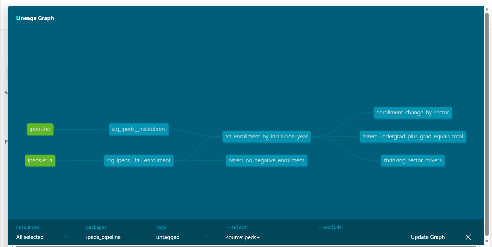

# IPEDS Enrollment Pipeline

A local data pipeline that turns raw federal higher-ed data (IPEDS) into a tested,
analysis-ready enrollment table using **dbt** and **DuckDB**.


```
data/raw/*.csv  ──►  staging (views)  ──►  marts (tables)  ──►  analyses
  HD, EF A           clean, cast, decode    one row per          enrollment change
                                            institution-year     by sector
```
## Lineage



## Stack
- **DuckDB**: reads the raw CSVs in place; no loading step
- **dbt**: models, tests, seeds, documentation
- **Data**: IPEDS Complete Data Files, National Center for Education Statistics (public domain)

## Setup

```bash
python -m venv .venv
source .venv/bin/activate          # Windows: .venv\Scripts\activate
pip install -r requirements.txt
```

## Get the data

1. Go to the IPEDS Data Center → **Complete Data Files** (nces.ed.gov/ipeds/datacenter/DataFiles.aspx)
2. For the **two most recent years** available, download the data file (not the dictionary) for:
   - **HD**: Institutional Characteristics, Directory information (`HDyyyy.zip`)
   - **EFyyyyA**: Fall Enrollment, race/ethnicity, gender, attendance status, level (`EFyyyyA.zip`)
3. Unzip and put the CSVs in `data/raw/`, so you have e.g.:
   ```
   data/raw/hd2023.csv   data/raw/ef2023a.csv
   data/raw/hd2024.csv   data/raw/ef2024a.csv
   ```
4. Also download the **dictionary** zips and keep them handy. You'll need them to check codes.

**Revised files:** some zips contain both `hd2023.csv` and `hd2023_rv.csv`. Keep only the
`_rv` (revised) version and rename it to the standard name (`hd2023.csv`). If both end up in
`data/raw/`, the `unique` test on `institution_year_key` fails. That's on purpose.

## Run

```bash
dbt build --profiles-dir .        # seeds + models + tests, in dependency order
dbt show  --profiles-dir . -s enrollment_change_by_sector --limit 50
dbt docs generate --profiles-dir . && dbt docs serve --profiles-dir .   # lineage graph
```

## Models

| Model | Grain | Purpose |
| `stg_ipeds__institutions` | institution × year | Directory data, codes decoded via the `sector_codes` seed |
| `stg_ipeds__fall_enrollment` | institution × year × student level | Fall headcount, typed |
| `fct_enrollment_by_institution_year` | institution × year | Total / undergrad / grad headcount + year-over-year change |

## Data quality checks

- `unique` + `not_null` on the institution-year key (catches duplicate source files)
- `relationships`: every enrollment row has an institution; every sector code is known
- `assert_no_negative_enrollment`: headcounts can't be negative
- `assert_undergrad_plus_grad_equals_total` (warn): reconciles level totals

## Design decisions

- **Read CSVs in place, all columns as text.** Raw data is never type-guessed; staging owns every cast (`try_cast`), so a bad value becomes a null that tests catch instead of a failed load.
- **`union_by_name`.** IPEDS adds, drops and renames columns between years. Stacking by column name means a new year can't silently shift values into the wrong column.
- **Year comes from the file name**, because IPEDS files don't carry a year column.
- **YoY change only against the actual prior year.** If an institution skipped a year, the change is null rather than a misleading two-year jump.
- **Sector analysis counts only institutions present in both years**, so openings and closures don't read as growth or decline.

## Findings

**Fall enrollment grew 3.5% from 2023 to 2024.** Across 5,789 institutions that reported in both years, headcount rose from 19.66M to 20.35M (+688K). Every sector grew except one.

| Sector | Institutions | Fall 2023 | Fall 2024 | Change |

| Public, 4-year or above | 847 | 9,607,699 | 9,907,259 | +3.1% |
| Public, 2-year | 834 | 4,321,334 | 4,548,459 | +5.3% |
| Private nonprofit, less-than-2-year | 53 | 7,667 | 7,473 | −2.5% |

Public 2-year colleges grew fastest of the large sectors, adding 227K students.


## What I'd change at scale

This version runs locally on about 23K enrollment rows. At 100x the data, or with more sources, I'd change:

- **Storage:** land raw files in S3 and convert them to Parquet partitioned by `survey_year`. Queries that touch one year then scan one partition instead of every CSV.
- **Query engine:** switch the dbt adapter from DuckDB to Athena (or Spark for heavier transforms). The SQL models barely change; only the source definitions and profile do.
- **Incremental loads:** make the fact table `incremental` keyed on `unitid` + `survey_year`, so a new year's release processes only that year, and reprocessing a revised (`_rv`) file replaces its rows instead of duplicating them.
- **Ingestion:** script the IPEDS download and validate each file's schema before it enters the pipeline. A file with a missing or renamed column goes to a quarantine folder instead of breaking the build.
- **Orchestration:** schedule the run (Airflow, or GitHub Actions for something this small), and alert on test failures instead of checking output by hand.
- **Data model:** add a `dim_parent_organization` from the shared 6-digit OPEID, so multi-campus systems can be analyzed together. That fixes the misleading sector result above.
- **More sources:** add 12-month enrollment (EFFY) and completions, joined on `unitid` + `survey_year`.
